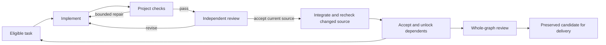

# Agentic Coding Workflow

A Claude Code plugin for scoped implementation, useful review, and verifiable
delivery. Use one continuing session for ordinary work. Use **Relay** when the
work needs enforced execution limits, dependent workers, or durable recovery.

## Start here

Install [Claude Code](https://code.claude.com/docs/en/setup), then run:

```text
/plugin marketplace add XaoticLabs/agentic-coding-workflow
/plugin install agentic-coding-workflow@agentic-coding-marketplace
```

For development, run `make setup` and `make check`; see
[validation and maintenance](#validation-and-maintenance) for prerequisites.
Then validate with `claude plugin validate .` and launch
`claude --plugin-dir "$PWD"`. Reload changes with `/reload-plugins` or restart.
The scripts use Python 3.11+, Git, Bash, and—in existing shell helpers—jq.
tmux is needed only for explicitly selected terminal/session workflows.
Relay requires Linux, macOS, or WSL for POSIX process groups and file locks.

Configure the consuming project's actual commands in
`.claude/project-commands.json`. Keep runtime artifacts ignored in that project:

```gitignore
.claude/*
!.claude/rules/
!.claude/skills/
```

Project configuration can instead be committed using targeted exceptions. Keep
secrets outside tracked configuration. Missing checks are unconfigured, not
passing. Explicit null/empty commands disable that action under project policy.
See [project readiness](references/project-readiness.md) for Go/Python/TypeScript
and mixed projects; optional Python profiles live in [profiles/python](profiles/python/uv-ruff-basedpyright/README.md).

```json
{
  "lint": "make lint",
  "test": "make test",
  "verify": "make verify-user-paths",
  "quick_check": "make check-changed",
  "format": "make format"
}
```

These example commands must exist in your project. `verify` is an optional
runtime gate in Relay. `quick_check` is an optional advisory edit hook; it never
replaces final verification. Formatting is explicit; verification runs check-only
commands. `scripts/configure-project.sh` can refresh an operations guide while
preserving configured overrides; it does not invent Go/Python/Node CI policy.

## Three everyday recipes

**Fix a regression.** Start with the observed failure and the behavior expected:

```text
/agentic-coding-workflow:implement "Fix the retry handler losing cancellation; add a regression and run the configured checks"
```

Inspect relevant code, reproduce, implement, verify, and report. Use
`/agentic-coding-workflow:debug-bug` for uncertain root causes. A small change
does not require a separate spec, worktree, committee, or approval round.

**Build a feature.** Plan when uncertainty or scope warrants it:

```text
/agentic-coding-workflow:plan "Add cursor pagination to the audit API"
/agentic-coding-workflow:implement "Implement the agreed pagination plan"
```

Continue related work in the same session. An existing ticket can supply the
criteria; `/implement ABC-123 --tracker jira --worktree --review` requests an
isolated implementation and independent review. `/write-spec` is for detailed
handoffs, `--interview` selects deeper planning, and `--approve-tests` selects
human approval of acceptance-test expectations. Ordinary TDD needs no approval
of agent-authored tests or separate RED/GREEN commits.

For ordinary unattended continuation, set a native goal in that session:

```text
/goal The agreed pagination criteria hold, configured tests and lint pass, and the final verification evidence is shown.
```

Native goals judge surfaced evidence; they do not execute independent tests or
replace project review requirements. Use native compaction/resume for continuity.

**Prepare review and delivery.** Produce a change a reviewer can assess:

```text
/agentic-coding-workflow:review
/agentic-coding-workflow:ship --draft --follow-up
```

Ship when requested and authorized. It prepares/publishes a PR and optionally
follows CI/review feedback; it does not merge or deploy. Keep an explicit record
of changed behavior, verification, and remaining gaps. The existing shared
repair budget is three completed review rounds per logical change, including
local and remote feedback. See [review policy](references/review-policy.md) and
[ticket-to-PR follow-up](references/delivery-follow-up.md).

## Relay: the specialized supervisor

```text
/agentic-coding-workflow:write-spec pagination --relay
/agentic-coding-workflow:relay pagination --once
/agentic-coding-workflow:relay pagination --resume
/agentic-coding-workflow:relay pagination --status
```

Relay's fixed execution graph is:



The supervisor owns task state, commits, worktrees, deadlines, and acceptance.
Workers implement scoped tasks and leave edits uncommitted. Deterministic project
checks and a separate read-only reviewer verify the same source. A plan checkbox
or a worker saying done cannot accept a task. Combining parallel candidates
requires checks and review of the combined source.

Defaults: one worker, 50 implementation calls, three attempts per task,
600 seconds per process, 3,600 total active seconds across resumptions. No
unlimited mode. `--workers N` permits up to six disjoint workers;
`--parallel N` is an alias. `--once` may return incomplete. A clean initial
checkout, an existing task plan, and configured verification are required.

The original branch remains untouched. Failed and accepted candidates, logs,
and state are preserved. Conflicts, changed guidance/source, missing review,
timeouts, or exhausted budgets stop explicitly. There is no automatic publish,
final merge, destructive reset, or global cleanup sweep.

```bash
python3 "${CLAUDE_PLUGIN_ROOT}/scripts/relay.py" pagination --workers 2 --time-budget 300 --run-budget 1800
python3 "${CLAUDE_PLUGIN_ROOT}/scripts/relay.py" pagination --stop
```

Records live in `.claude/relay/<slug>/runs/<id>/`: typed `state.json`, append-only
`events.jsonl`, and raw per-node process/check/review evidence. Stop cancels
owned process groups. Resume validates the checkpoint and rechecks accepted
source; it does not reset limits or silently adopt a changed branch.

Relay replaces Ralph without a compatibility entrypoint. Existing run artifacts
are retained; see the [supervisor contract](skills/relay/references/supervisor.md)
for the current interface and execution behavior.
Use [manual parallel/reunify](skills/parallel/SKILL.md) for independently steered
branches and [worktree cleanup](skills/git-worktree/SKILL.md) when explicitly
reclaiming owned, safely merged work.

## Graph engineering and decision models

Separate three concerns: the task dependency DAG, bounded execution transitions,
and evidence that connects criteria to observed outcomes. Add specialized nodes
where context, capability, independence, or recovery warrants them. Keep tightly
coupled work together. Deterministic checks do not need an LLM node.

[Graph engineering](references/graph-engineering.md) explains this design, the
useful pstack/gstack patterns it adopts, and corrections to common claims about
context isolation, prompt constraints, flake retries, and multi-agent benchmarks.
There is no dependency on either external workflow pack.

Jev/Laya integration starts with **failure observations**. Rules classify locally
by default. Explicit `--triage-config` enables a Jev-compatible API call beside
the rule result. Both remain advisory: neither can approve work, waive a check,
retry a command, change a permission, or publish. No hook calls a decision model
by default. See [decision models](references/decision-models.md) for configuration,
data boundaries, and evaluation before promoting a classifier into routing.

## Hooks and verification

All lifecycle registrations live in [hooks/hooks.json](hooks/hooks.json).

| Event | Behavior |
| --- | --- |
| `PreToolUse` | Existing dangerous-command and protected-path checks |
| `SessionStart` | Cheap checkout/branch/check-configuration report; no tests run |
| `PostToolUseFailure` | Local failure evidence and heuristic category; no automatic retry |
| `PostToolUse` for edits | Only the project's explicit advisory `quick_check` |
| `Notification` | Native desktop alert when input is needed |
| `StopFailure` | API-error log and best-effort alert; cannot recover the failed turn |
| `Stop` | Task-graph validation and final project lint/test checks; a separate response-finished notification |

Notifications support macOS `osascript` and Linux `notify-send` when available;
set `WORKFLOW_NOTIFY=false` to disable them. They do not send external messages.
Hooks for one event run concurrently, so a response-finished notification is not
a verification-completed signal. Relay sends its terminal status after its own
gates finish. Optional observations fail open; required Stop gates intentionally
block unverifiable requirements and have failure/timeout blocking configured.

Final checks are tied to HEAD and a source fingerprint, including ignored
workflow guidance. Changed source invalidates previous success. Correction
attempts are bounded; exhaustion is reported as blocked. Tests must preserve
acceptance criteria, with rationale and independent review of corrections.

`/agentic-coding-workflow:verify-project` exercises a real CLI/API/browser/worker
path and retains source-bound evidence. When requested, it creates and proves a
reusable project-local verification runbook. The `runtime-verifier` agent is
available for independent exercises; `evaluator` performs read-only code review.
See [runtime evidence](references/verification-evidence.md).

Tool grants and prompt instructions are not an OS sandbox. Review tool lists
are restricted; implementation and runtime verification use shell tools. For
hard filesystem/network boundaries, use [contained execution environments](references/execution-environments.md).

## Optional tools

Use namespaced commands: `/agentic-coding-workflow:<name>`.

| Purpose | Commands/skills |
| --- | --- |
| Context and design | `prime`, `plan`, `write-spec` |
| Implementation and delivery | `implement`, `test`, `review`, `ship` |
| Bounded or manually parallel work | `relay`, `spawn`, `parallel`, `reunify`, `dashboard`, `git-worktree` |
| Investigation | `debug-bug`, `troubleshoot`, `query`, `analyze` |
| Understanding and upkeep | `explain`, `visualize`, `techdebt`, `update-rules`, `harness-audit` |
| Reusable capabilities | `verify-project`, `devex-review`, `test-audit`, `skill-forge`, `pr-reviewer` |

The tmux, Neovim RPC, database-analysis, and language-specific integrations remain
optional. Nothing in the default recipe requires adopting them. Choose
subagents versus primary sessions from tool access, work ownership, context,
and oversight; implementation does not inherently need a separate primary.

Shared helpers cover [CLI/API tickets](references/ticket-trackers.md),
[batch experiments](references/experiments.md), [model selection](references/model-policy.md),
and [read-only lifecycle observations/schedules](references/lifecycle-observation.md).
No provider integration, schedule, company rollout, or remote notification is
activated by installing this plugin.

## Validation and maintenance

For repository development, install Git, Bash, Make, jq, and
[uv 0.11.26](https://docs.astral.sh/uv/getting-started/installation/#installing-a-specific-version).
Python 3.11 is selected by `.python-version`; uv downloads it if necessary.
From a fresh checkout, run:

```bash
make setup
make check
```

`make setup` creates `.venv` and installs the development dependencies from
`uv.lock`, including pytest's transitive dependencies such as Pygments. It fails
if the lockfile is stale. Rerun it after dependency changes or switching branches.
No environment activation or global pytest installation is needed.
The uv cache stays in the ignored `.cache/uv` directory so repository-scoped
agent sandboxes can write it.

`make check` runs `make lint` (Ruff and hook registration validation) and
`make test` (the deterministic pytest suite). These checks do not install
dependencies or fix files; a missing or stale environment fails with setup
instructions. CI runs the same setup and checks. The tracked
`.claude/project-commands.json` selects these tasks for local agents and the Stop
hook, so this repository reports `configured` readiness and verifies both checks.

For focused tests and configuration inspection:

```bash
uv run --frozen --no-sync --offline python -m pytest -q tests/test_project_commands.py
python3 scripts/project-commands.py readiness .
```

To change dependencies, edit `pyproject.toml`, run `uv lock`, then run
`make setup` and `make check`. Commit the manifest and lockfile together.
The uv version is pinned in `pyproject.toml`, which CI reads as well.

With Claude Code installed, also validate the native plugin:

```bash
claude plugin validate .
```

Validate skill entrypoints with
`python3 skills/skill-forge/scripts/validate-skill.py skills/relay --json`.
Native behavioral evaluation follows [evals/README.md](evals/README.md), keeping
tuning and final holdout cases separate. Local fixture tests establish controller
and adapter behavior; they do not establish live-provider accuracy or a delivery
speedup. Retain actual results and `NOT_RUN` limitations in `evals/benchmarks/`.

Before adding another review layer or retiring a safeguard, use `harness-audit`
to compare the native-session baseline and proposed workflow on representative
cases. Measure accepted behavior, useful defects caught, false findings, human
effort, time, and total cost. For team adoption, have another developer execute
the three recipes from a fresh checkout and fix the friction they encounter.
