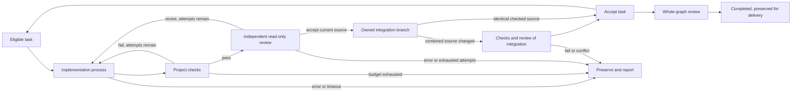

# Relay supervisor contract

Relay is the bounded executor for tasks that need external limits, dependency
ordering, independent acceptance, or recoverable workers. Ordinary feature work
uses one continuing native session and `/goal`. Relay is deliberately a fixed
graph, not a general graph framework or a second conversation manager.

## Nodes, edges, and state



The controller is the only state writer. `state.json` is an atomically replaced
typed run checkpoint; `events.jsonl` records transitions. Each task carries its
attempt count, owned branch/worktree, base/candidate commits, checked source,
feedback, and pointers to process/check/review evidence. Separate CLI processes
have separate contexts. A worker receives its task, relevant topic spec, frozen
project checks, scope policy, and prior feedback; it does not receive sibling
transcripts. The final reviewer receives all criteria and integration evidence.

The task dependency graph is the existing JSON `## Task Index`, parsed by
`scripts/task-plan.py`. Unknown IDs, duplicates, and cycles fail before workers
start. A dependent is eligible only after its prerequisites are accepted in the
integration worktree. Tasks marked done in an input plan are baseline context;
the whole-graph review still examines their criteria. The input plan is not
rewritten as proof of progress.

## Acceptance and preservation

- Snapshot configured `lint`, `test`, and optional `verify` commands before work.
  Require lint/test entries, honor explicit null disables, and require at least
  one executable check. No implicit language tooling or passing missing checks.
- Workers leave edits uncommitted. The controller checks scope and frozen
  guidance, commits a candidate, runs commands under `bash -o pipefail`, and
  invokes the existing restricted read-only evaluator.
- Every accepted patch requires project checks and independent review against
  the same commit and worktree fingerprint. A changed HEAD, source, spec, rules,
  or project commands invalidates evidence. Tests may be corrected with rationale
  and independent review; acceptance criteria cannot be weakened to get green.
- Fast-forwards reuse evidence only when the entire checked source matches.
  Combining sibling branches creates a new candidate and requires fresh checks
  and review. Conflicts stop with all work preserved; Relay does not ask another
  agent to resolve and silently approve them.
- The original checkout and branch remain unchanged. All candidate worktrees,
  failed attempts, and logs are retained. Rejected work is excluded from the
  accepted branch; there is no destructive reset or automatic worktree sweep.
- A final independent review covers the complete graph. `completed` means the
  configured verification and review succeeded for the preserved candidate.
  It does not mean published, merged, deployed, or defect-free.

Workers default to serial execution. `--workers N` permits up to six independent
worktrees; unknown or overlapping planned file ownership stays serial. Git
integration remains serialized. Use existing `/reunify` and delivery commands
for a separately authorized final integration/publish decision.

## Limits, cancellation, and recovery

Defaults: 50 implementation calls overall, three attempts per task, 600 seconds
per process, 3,600 seconds of active execution across resumptions. All limits
must be positive and finite. Iterations and attempts never reset on resume.
`--once` bounds the invocation to one implementation call and can return
`incomplete`. Process timeouts terminate owned process groups, including children.
`--stop` or an interrupt cancels owned execution and preserves the checkpoint.
Short local Git/bookkeeping operations have separate bounded subprocess timeouts;
an expired run cannot traverse an acceptance edge.

`--resume` reopens the latest run under an exclusive per-spec supervisor lock.
It verifies project identity, unchanged source/guidance/plan/policy, ownership,
and the integration checkpoint; it reruns checks and review before continuing
accepted dependencies. The original limits persist. A conflicting integration,
worker on an outdated base, changed project, or exhausted budget needs inspection
or a new explicitly scoped run, not a hidden reset or automatic rebase.

Status and evidence:

```bash
python3 "${CLAUDE_PLUGIN_ROOT}/scripts/relay.py" feature --status
python3 "${CLAUDE_PLUGIN_ROOT}/scripts/relay.py" feature --stop
python3 "${CLAUDE_PLUGIN_ROOT}/scripts/relay.py" feature --resume
```

Records: `.claude/relay/<slug>/runs/<run-id>/state.json`, `events.jsonl`, and
per-task attempt/check/review directories. Read process result files for argv,
working directory, timestamps, raw exits, timeouts, and stdout/stderr hashes.
Requested and observed model IDs remain separate. The `.claude/` runtime
directory must be ignored in consuming projects; tracked rules/configuration
continue to work. The CLI requires a clean initial Git checkout.

## Scope and actual isolation

Optional `.claude/relay-policy.json`:

```json
{
  "allowed_paths": ["src/", "tests/"],
  "protected_paths": ["src/auth/", "src/billing/", ".github/workflows/"]
}
```

Scope checks reject forbidden changes before integration. Workflow guidance and
secret paths are protected by default. These are acceptance controls, not a
filesystem sandbox: the implementation process has shell tools and runs project
code. Native permissions still apply; Relay does not use
`--dangerously-skip-permissions`. Its worker tool allowlist is not a restriction
on what arbitrary shell code can do. For untrusted workloads or a hard host or
network boundary, use an externally enforced contained environment described in
[execution environments](../../../references/execution-environments.md).

The reviewer has only Read/Glob/Grep, explicit write/shell/MCP denies, empty MCP
configuration, and no lifecycle hooks. It cannot execute runtime probes; those
belong to deterministic project checks or a separately contained runtime verifier.
Worktree metadata, model reports, and local JSON do not authenticate human
approval and are not a security boundary against hostile same-user processes.

## Ralph migration

Use `/relay` and `scripts/relay.py`. The Ralph entrypoint and launcher have been
removed. Old `.claude/ralph/` artifacts are preserved; do not convert their
completion flags into accepted Relay checkpoints.

| Previous option/behavior | Relay replacement |
| --- | --- |
| `<slug>`, `--once`, `--max`, `--time-budget`, `--status`, `--stop` | Same intent, under Relay's preserved-source contract |
| `--parallel N` | Alias for `--workers N`; one supervisor owns integration |
| `--plan` | `/write-spec <slug> --relay` or an existing structured plan |
| `--harvest` | Explicit `/update-rules`, supported by actual run evidence |
| `--no-eval`, `--eval-per-iter`, `--eval-gates-merge` | Retired; every accepted task and combined candidate requires independent review; no automatic final merge |
| `--clean-room` | Put relevant greenfield context in the task; source inspection remains available |
| `--checkpoint-every`, inject files, arbitrary shell overrides | Inspect status, stop, and resume; material scope changes start a new run |
| `--time-budget=0` | Retired; select a finite per-process and total-run budget |
| Automatic tmux, generated briefings, worker-edited plans, reset/revert loops | Explicit tmux when requested; scoped node inputs and controller-owned state |

Unsupported options are rejected before launching a model. No legacy flag
silently disables a required gate. Read-only historical trace tools remain in
`scripts/stream-processor.py` and `scripts/trace-viewer.py`; they do not execute
the retired scheduler.
